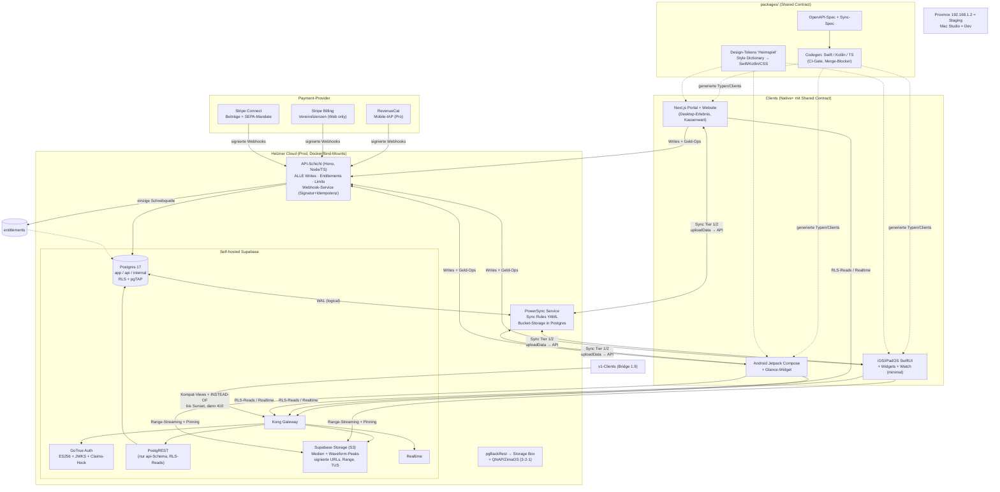

# RollsportManager v2 — Verbindlicher Gesamt-Blueprint

**Status:** VERBINDLICH (Architektur-Panel konsolidiert, Chef-Architekt-Entscheid)
**Datum:** 2026-07-10
**Grundlage:** `00-STUDIE-SYNTHESE.md` + Reports `research/01–14` + Red-Team-Review (E1), Backend-/Security-Architekt (E2–E4, E6–E7), Sync-/Infrastruktur-Architekt (E5, E8)
**Design-Richtung:** „Heimspiel" (Konzept C — Warm & Vereinsnah)

---

## 1. Vision & Produktprinzipien

### 1.1 Vision

RollsportManager v2 ist **die Vereins-Plattform für Rollkunstlauf im DACH-Raum**: Ein Generalisten-Fundament (Mitglieder, Termine, Beiträge — auf Spond-/easyVerein-Niveau) mit einem Nischen-Moat, den kein Generalist bedient — dem **Küren-Modul** (Kür-Verwaltung, Trainings-Audio-Player mit Tempo/A-B-Loop/Countdown/Waveform, Wettkampf-Live-Scoring, RollArt-Wertung). v1 hat bewiesen, dass das Domänenmodell trägt; v2 stellt es auf ein sicheres, wartbares, bezahlbares Fundament.

**Leitsatz:** Das Domänenwissen von v1 wird geplündert, der Code-Korpus nicht. v1 ist Spezifikation, nicht Basis.

### 1.2 Produktprinzipien (Definition of Done für jedes Feature)

1. **Kern vs. aktivierbare Module.** Der Kern (Mitglieder/Teams/Familie, Termine/Anwesenheit, Küren-Basis, Kommunikation, Beiträge) ist immer an. Alles andere (Wettkampf, Buchhaltung, Pflichtstunden, Equipment, Hallen, Schließfächer, Gamification, Galerie …) ist ein **pro Verein aktivierbares Modul** mit eigenem Navigations-Slot und Lizenz-Tier-Bindung. Kein Feature landet ungefragt in der Navigation aller Nutzer — das beendet die 45-Ziele-Navigation von v1.
2. **Rollenbasierte Workspaces.** Vier Home-Erlebnisse statt einer Einheits-Navigation: **Trainer** (Training/Küren/Anwesenheit/Wettkampf), **Vereins-Admin/Kassenwart** (Mitglieder/Beiträge/Mahnwesen/Finanzen — primär im Web-Portal), **Mitglied/Eltern** (Termine, Zu-/Absagen, Zahlungen, Familien-Verwaltung, Eltern-Modus statt separater Eltern-App), **Gasttrainer** (befristeter, granular beschnittener Trainer-Workspace).
3. **Serverseitige Wahrheit.** Entitlements, Rollen, Limits und Zahlungen werden ausschließlich serverseitig durchgesetzt (KetoTracker-Lehre: Paywall nur im Client = Umsatzleck). Kein Zahlungs-Button existiert in v2, bevor er end-to-end funktioniert.
4. **Offline ist Produktversprechen, nicht Nachtrag.** Das Kern-Szenario ist die Halle/das Turnier ohne Empfang. Anwesenheit, Zu-/Absagen, Kür-Notizen und Chat funktionieren offline (Tier 1); Kür-Musik ist explizit pinnbar („für Wettkampf offline halten").
5. **Zweisprachig DE/EN ab dem ersten String**, echte Umlaute (ä/ö/ü/ß, nie ae/oe/ue/ss), FR/RU/TR aus dem v1-Übersetzungsbestand (~1.410 Keys × 5) nach Bereinigung nachziehen. Dark Mode und Accessibility (Labels, Dynamic Type, Kontrast — BFSG) sind Merge-Kriterium, kein Backlog.
6. **Design „Heimspiel":** warm, vereinsnah, nahbar — ein Design-Token-System (Style Dictionary → Swift/Kotlin/CSS) ist das erste UI-Artefakt; keine Ad-hoc-Farben (v1: 631), keine fixen Schriftgrößen (v1: >130).
7. **Kein Feature ohne Vertrag.** Jedes Feature beginnt beim Schema/Contract (Codegen), nicht bei der UI. Contract-Tests sind Merge-Gate.

---

## 2. Architektur-Entscheidungen E1–E8 (ADR-Liste, final)

Konsolidierung des Panels. Alle Entscheidungen sind **beschlossen**; Abweichungen nur über ein neues ADR mit Begründung.

### ADR-E1 — Client-Stack: Native+ mit Shared Contract (Option A), mit 4 bindenden Auflagen

**Entscheidung:** SwiftUI (iOS/iPadOS + Watch/Widgets) + Jetpack Compose (Android) + Next.js/React/TS (Web-Portal & Website). Typen werden aus dem Schema/OpenAPI generiert (Swift/Kotlin/TS), Online-Fachlogik liegt in der API-Schicht, Design-Tokens sind geteilt.

**Bindende Auflagen (nicht verhandelbar):**
1. **Codegen-Gate vor Feature Nr. 1:** Der Schema→Swift/Kotlin/TS-Generator existiert und läuft grün in CI, bevor irgendein Feature-Code entsteht. Quelle ist die OpenAPI-Spec der API-Schicht (nicht direkt `information_schema`) — damit ist der Generator Standard-Tooling-nah (openapi-generator/swift-openapi-generator + eigene Templates) statt reiner Eigenbau.
2. **Offline-Logik = anerkannte 3x-Client-Logik:** Outbox-Verhalten, Konfliktregeln und Queue-Semantik (Anwesenheit/Zusagen/Chat) werden als geteilte Spezifikation in `packages/contracts/sync-spec.md` fixiert und über Contract-/Roundtrip-Tests pro Plattform abgesichert. „Fachlogik in RPCs" gilt nur für Online-Fachlogik (Beiträge, Mahnstufen, Entitlements).
3. **macOS-Target gestrichen.** Primäres Desktop-Erlebnis ist das Next.js-Portal. Es gibt keine `#if os(macOS)`-Pfade in v2. (Falls die iOS-App später als „Designed for iPad on Mac" gratis läuft: unbeworben, ungewartet, ohne Sonderfälle.)
4. **Android nach iOS + Kipp-Trigger:** Android v2 startet erst nach stabilem iOS v2. Die Repository-Schicht bleibt KMP-extraktionsfähig (keine UI-Logik in Repositories, Interfaces + reine Kotlin/Swift-Datentypen). Kipp-Trigger: Fällt Android >~6 Monate hinter iOS zurück ODER kehren Drift-Bugs trotz Codegen zurück → Entscheidung neu aufrollen (KMP für Datenlayer oder Flutter für Android).

**Begründung (aus dem Red-Team-Review):** A gewinnt nicht wegen Watch (v1-Watch ist tot) und nicht wegen AI-Velocity (v1 driftete trotz AI), sondern wegen: (a) der Produkt-Moat ist das nativ-anspruchsvollste Feature — Kür-Audio mit Time-Pitch 0,5–2,0x, A-B-Loop, gehaltenem Audio-Focus als Media3-Foreground-Service; in Flutter wäre exakt der USP das höchste Einzelrisiko, während v1 1:1 portierbare native Vorlagen liefert (`PlaybackService.kt`, AVAudioEngine+TimePitch); (b) minimales Migrationsrisiko im Parallelbetrieb (Feature-für-Feature-Ablösung mit v1-Code als Porting-Template statt Doppel-Rewrite); (c) SwiftUI+Compose+Next.js sind die tiefsten Skills des Betreibers. KMP bleibt dokumentierter Plan B (löst nur Mobile↔Mobile, Web bleibt außen vor).

### ADR-E2 — Hosting & API-Schicht: Self-hosted Supabase auf Hetzner + dünne Node/TS-API

**Entscheidung:**
- **Prod:** Self-hosted Supabase auf Hetzner-Cloud (EU, Falkenstein/Nürnberg, ARM CAX31 oder CPX41), Docker mit Bind-Mounts, Postgres-Major fixiert (17), keine DB-Ports am Host, pgBackRest/wal-g mit Offsite (Hetzner Storage Box + Kopie auf QNAP/ZimaOS zu Hause = 3-2-1), Healthchecks.io-Monitoring.
- **Staging:** der leere Proxmox-Server (192.168.1.2). **Dev:** Mac Studio. Der Mac ist nie wieder Prod.
- **API-Schicht:** dünner, typisierter Node/TypeScript-Service (**Hono**, im selben Compose-Stack) für ALLE schreibenden Business-Operationen und alle Webhooks; liefert die OpenAPI-Spec für den Codegen. PostgREST-Direktzugriff nur für unkritische, RLS-geschützte Reads und Realtime. Edge Functions (Deno) nur, wo Supabase-Nähe zwingend ist — nicht als primäre API.

**Begründung:** Das v1-Problem war nie Self-Hosting, sondern Self-Hosting auf einem privaten Mac hinter einer Vodafone-Leitung mit täglichem WAN-Drop und Backups auf derselben Platte. Heim-Proxmox löst davon nichts (gleiche Leitung, Stripe-Webhooks brauchen zuverlässige Inbound-Erreichbarkeit). DSGVO (Minderjährige, SEPA) spricht für Self-Host in Deutschland statt Managed. Die API-Schicht ist der einzige saubere Durchsetzungspunkt für Entitlements/Rollen/Limits — PostgREST-Direktschreibzugriff hat die v1-Lecks (role-PATCH, activate_premium für alle) erst ermöglicht. Managed Supabase EU bleibt dokumentierter Plan B, falls Ops die Feature-Arbeit erdrückt.

### ADR-E3 — Auth: ES256, kurze Tokens, Rollen aus Claims + v1-Sofortprogramm

**Entscheidung:** Asymmetrische JWT-Signatur **ES256** (GoTrue mit JWKS; privater Schlüssel verlässt nie den Auth-Container). Access-Token **15 min**, Refresh-Token-Rotation mit Reuse-Detection (30 Tage Sliding Window). Rollen/Vereins-Zugehörigkeiten als Custom Claims (`club_roles: {club_id: role}`) über Custom-Access-Token-Hook aus `club_members` — nie aus einer PATCH-baren Spalte. Web: Refresh als HttpOnly/Secure/SameSite-Cookie, Access nur in-memory; Mobile: Keychain/EncryptedSharedPreferences. Sign in with Apple/Google von Anfang an (Store-Anforderung). **Defense in depth:** sicherheitskritische/finanzielle Mutationen prüfen in der API-Schicht zusätzlich gegen die DB (Claim-Staleness ≤15 min ist sonst ein Fenster).

**v1-Sofortprogramm (Phase 0, VOR jedem v2-Feature — siehe Abschnitt 6):** 8 Schritte in fester Reihenfolge: Secret-/Key-Rotation, `users`-WITH-CHECK + Rollen-Sperr-Trigger, `activate_premium`/`process_purchase`-Grants entziehen, Secret-Spalten-Views, Webhook-Signaturpflicht, `signing_keys.json` aus der Git-Historie, Passwort-Rotation (ch4ngeM3-Stamm verbrannt), Port-/Kong-/debug.html-Härtung. Zusammen 1–2 Arbeitstage. Ohne das ist jeder Monat Parallelbetrieb ein meldepflichtiger DSGVO-Vorfall auf Abruf.

### ADR-E4 — Identität & Mandanten: eine UUID-Identität, `club_members`, Mehrverein im Schema ab Tag 1

**Entscheidung:**
- `profiles.id UUID PK REFERENCES auth.users(id)` — das BIGSERIAL/UUID-Doppel entfällt ersatzlos.
- `club_members(club_id, user_id, role, status, valid_until, PRIMARY KEY(club_id, user_id))`, Rollen `owner/admin/treasurer/coach/member/guest_coach` **pro Verein**.
- Mehrvereins-Fähigkeit JA im Datenmodell und in RLS ab Tag 1; die v2.0-UI bleibt Ein-Verein (Vereins-Switcher ist späteres UI-Feature).
- Gasttrainer = normale befristete Mitgliedschaft (`role=guest_coach`, `valid_until`) statt Token-Sondertabelle; granulare Rechte-Flags aus v1 als generisches Permission-System darüber.
- Familien als `guardianships(guardian_id, child_id)` statt `parent_id/parent2_id`-Spalten; Kind-Konten ohne E-Mail = echte `auth.users` (Placeholder-Identität), Upgrade ab 16 = E-Mail anhängen.
- Plattform-Admin via `auth.users.app_metadata.platform_role`, nicht im Mandanten-Rollen-Enum.
- Jede Mandantentabelle: `club_id UUID NOT NULL` + Composite-Index; RLS liest aus JWT-Claims (ein Policy-Template, keine Subselect-Helper).

**Begründung:** Das v1-Ein-Verein-Modell ist die Wurzel dreier Verrenkungen (öffentliche Gast-Token-Tabelle, Phantom-Rolle „eltern", überregionale Events am Modell vorbei). Mehrverein kostet auf Schema-Ebene fast nichts, nachträglich kostet es ein RLS-/Claim-Redesign — die Asymmetrie entscheidet.

### ADR-E5 — Offline/Sync: PowerSync (self-hosted, Open Edition) + striktes Tiering + Medien außerhalb der Sync-Engine

**Entscheidung:**
- **PowerSync Open Edition** (`journeyapps/powersync-service`, FSL-1.1-ALv2 → nach 2 Jahren Apache 2.0) als EINE Sync-Engine für iOS, Android und Web; Sync-Bucket-Storage in **Postgres** (kein MongoDB im Stack); Quell-Postgres mit `wal_level=logical`; Sync Rules (YAML) versioniert im Repo.
- **Offline-Tiering:** Tier 1 lesen+schreiben offline (Anwesenheit/Check-in, Termin-Zu-/Absagen inkl. „krank", Kür-Notizen/Bewertungen, Chat-Outbox) · Tier 2 offline lesbar (Mitglieder, Termine, News, Übungsbibliothek) · Tier 3 NUR online, server-autoritativ (Zahlungen, Entitlements, Rollen, Lizenz).
- **Schreibpfad:** PowerSync-`uploadData` schreibt gegen die API-Schicht (Entitlements/Limits serverseitig), NICHT direkt via PostgREST; RLS bleibt zweite Verteidigungslinie. Konflikte: Last-Write-Wins über Server-`updated_at`; append-only wo fachlich möglich (Anwesenheits-Events, Chat, Notizen).
- **Medien bewusst AUSSERHALB der Sync-Engine:** Base64 raus aus Postgres, rein in Supabase Storage (S3-kompatibel); DB nur Metadaten (Pfad, SHA-256, Größe, MIME, Dauer) + serverseitig vorberechnete **Waveform-Peaks** (ffmpeg/audiowaveform). Streaming per HTTP-Range über kurzlebige signierte URLs; Uploads resumable (TUS). Offline-Medien über expliziten Download-Manager mit nutzersichtbarem **Pinning** („für Wettkampf offline halten"), LRU-Eviction, Checksum-Verifikation — genau EINE lokale Dateikopie, nie in der DB. Lokale SQLite verschlüsselt; kein passwordHash lokal, keine JSON-Schatten-Caches.
- **Plan B eingebaut:** Das Schema (UUID-PKs, `updated_at`-Trigger, `deleted_at`-Soft-Deletes, client-generierte Idempotenz-UUIDs) ist identisch mit den Voraussetzungen einer Eigenbau-Outbox — ein Ausstieg kostet Client-Code, kein Schema-Redesign.

**Begründung:** v1 beweist, dass Eigenbau-Sync beim Solo-Dev dreifach parallel entsteht und verrottet (alle read-only, kein Delta, keine Tombstones). Outbox+Delta+Konflikt+Tombstones auf 3 Plattformen korrekt zu bauen ist ein verstecktes Mehrjahresprojekt — und genau die Codeklasse, in der Claude Code am wenigsten hilft. ElectricSQL liefert nur den Read-Pfad.

### ADR-E6 — Payments: RevenueCat + Stripe Billing + Stripe Connect, eine `entitlements`-Tabelle

**Entscheidung:** Kein Eigenbau. Drei Säulen:
1. **RevenueCat** für Mobile-IAP (persönliches Pro-Abo) auf iOS UND Android.
2. **Stripe Billing** (Checkout + Customer Portal) für **Vereinslizenzen ausschließlich im Web-Portal** (spart 30 % Apple-Provision, umgeht Guideline 3.1.1; Apps zeigen Lizenzstatus nur an, Apple-konform ohne Steering-Texte).
3. **Stripe Connect (Express)** pro Verein für Mitgliedsbeiträge, inkl. **SEPA-Lastschrift** mit echtem Mandats-Management (FRST/RCUR, Pre-Notification). Vereine onboarden sich per Stripe-KYC selbst — nie wieder Vereins-Secrets in mandantenlesbaren DB-Spalten. Optionale Plattformgebühr pro Transaktion als zweite Einnahmequelle.

Alle Provider-Events laufen in EINEN Webhook-Service der API-Schicht: verpflichtende Signaturprüfung, Idempotenz per Event-ID-Tabelle, Betragsabgleich → einzige Entitlement-Quelle **`entitlements`** (`subject_type/subject_id/entitlement/source/valid_until/provider_ref`), nur durch die API-Schicht beschreibbar, Clients nur SELECT auf eigene Zeilen. **Banküberweisung bleibt vollwertiger Fallback** mit EPC-QR (GiroCode) + manuellem Matching-UI (Connect-KYC kann Wochen dauern). PayPal wird nicht übernommen. Gebühren-Aufschlag je Zahlart entfällt ersatzlos. Exit-Pfad dokumentiert: RevenueCat ist nur eine Quelle; Wechsel auf ASSN v2 + Play RTDN tauscht den Zulieferer, nicht das Modell.

### ADR-E7 — Schema & Preismodell: Englisch/snake_case, frische DB ohne Kompat-Layer im Schema-Design, Spond-Preismuster

**Entscheidung Schema:** Durchgängig Englisch, snake_case, ASCII (keine Umlaut-Spalten); Beträge `amount_cents BIGINT`; Status als dokumentierte englische Enums mit Zustandsautomaten; **UUIDv7-PKs**; `updated_at` per moddatetime-Trigger; Soft-Deletes auf Sync-Tabellen. „Kür" heißt im Schema **`routines`** (`routine_media`, `routine_ratings`, `routine_markers`) — Deutsch existiert nur in i18n. Schema-Trennung: `app` (Tabellen) / `api` (Views+RPCs, einziges PostgREST-exponiertes Schema) / `internal` (Queues, Jobs). v2 bekommt eine frische Datenbank; der Übergang ist ein einmaliges, testbares, idempotentes ETL (Quelle: eingefrorener `pg_dump --schema-only` der Live-DB als einzige Ist-Wahrheit); deutsche Enums werden deterministisch gemappt (offen→open, zusage→going; Mahnstufen auf EIN 5-Stufen-Enum normalisiert).

**Entscheidung Preismodell (Spond-Muster):** Der Verein zahlt die Staffel (Anker 9/29/59 €/Monat nach Mitgliederzahl, **serverseitig erzwungen** inkl. `max_members` und Trial-Read-only nach Ablauf). Mitglieder und Eltern nutzen die App **kostenlos und werbefrei** — Werbung entfällt komplett (DSGVO-/Reputationsrisiko gegenüber Minderjährigen). Optional EIN persönliches „Pro"-IAP (4,99 €) nur für vereinsunabhängige Personal-Features (eigene Küren/Trainings-Audio über das Vereinskontingent hinaus). Ein `products`-Katalog ist Single Source of Truth für Website, Apps, StoreKit- und Stripe-Konfiguration. Beta-Vereine werden als `entitlements(source=manual)` mit Ablauf gegrandfathered.

**Klarstellung zum scheinbaren Widerspruch E7↔E8:** E7 lehnt Kompat-Views als *Schema-Design-Prinzip* ab (v2-Schema wird nicht um Altlasten herumgebaut); E8 nutzt eine *bewusst minimale, wegwerfbare* v1-Kompat-Schicht (nur die real genutzten Endpunkte, aus Access-Logs ermittelt, Rest 410) als *Migrations-Werkzeug* mit definiertem Ablaufdatum (Phase 5: Drop). Beides gilt. Die Kompat-Schicht ist Migrations-Infrastruktur, nie API-Vertrag.

### ADR-E8 — Migration: Phase 0 vorgezogen, EIN früher Cutover, dann gemeinsames v2-Backend

**Entscheidung:** Reihenfolge Backend-Härtung → Next.js-Portal → iOS → Android → v1-Sunset, mit zwei Präzisierungen:
1. **Phase 0** (v1-Sicherheits-Notprogramm) läuft SOFORT, entkoppelt vom v2-Zeitplan, inkl. **v1.9-Bridge-Release** (neuer anon-Key ist in Clients eingebacken + KONFIGURIERBARE Backend-Base-URL als Cutover-Hebel).
2. **EIN einmaliger Daten-Cutover früh** (nach Phase 1, Wartungsfenster wenige Stunden, 1,3 GB ist Big-Bang-tauglich, NIE an einem Wettkampf-Wochenende). Danach laufen v1- UND v2-Clients gegen DASSELBE v2-Backend über die v1-Kompat-Schicht — kein Doppel-Datenbestand, keine Zwei-Wege-Synchronisation.

Details, Fertig-Kriterien und Zeitachse in Abschnitt 6.

---

## 3. System-Architektur (Diagramm)



---

## 4. v2-Datenmodell-Leitplanken

**Namens- und Typ-Regeln (hart):**
- Englisch, snake_case, ASCII. Fachbegriffe: Kür=`routine`, Verein=`club`, Termin=`event`, Anwesenheit=`attendance`, Beitrag=`fee`/`membership_fee`, Mahnung=`dunning_notice`.
- PKs: **UUIDv7** (`id UUID PRIMARY KEY DEFAULT uuidv7()`); client-generierbar für Offline-Idempotenz.
- Beträge: `amount_cents BIGINT` + `currency CHAR(3) DEFAULT 'EUR'`. Nie FLOAT, nie Dezimal-Strings.
- Zeit: `TIMESTAMPTZ`, alles UTC; `created_at`/`updated_at` auf jeder Tabelle, `updated_at` per moddatetime-Trigger.
- Status: englische Enums mit dokumentiertem Zustandsautomaten (z. B. `routine_status: draft → ready → competition → archived`; `rsvp_status: going/declined/maybe/sick`).
- Soft-Deletes: `deleted_at TIMESTAMPTZ` auf allen Sync-Tabellen (Tier 1/2) — Tombstones für PowerSync. Harte Deletes nur auf Nicht-Sync-Tabellen; GoBD-pflichtige Finanzdaten werden **anonymisiert statt gelöscht** (Art. 17(3)(b)), nie `ON DELETE CASCADE` auf Finanz-FKs (RESTRICT).
- Nummernkreise (Rechnungen) über Sequenz/Advisory-Lock — nie `COUNT(*)+1` (v1-Race).

**Mandanten-Modell:**
- Identität: `profiles.id UUID = auth.users.id`. Kein zweites ID-System.
- Mitgliedschaft: `club_members(club_id, user_id, role, status, valid_until)` — Rollen `owner/admin/treasurer/coach/member/guest_coach`. Familien: `guardianships(guardian_id, child_id)`.
- Jede Mandantentabelle trägt `club_id UUID NOT NULL` + Composite-Index `(club_id, …)`.

**RLS-Prinzipien:**
- EIN Policy-Template pro Zugriffsklasse, das `club_roles`-Claims aus dem JWT liest (`auth.jwt()->'club_roles'`), keine Subselect-Helper-Funktionen pro Zeile.
- PostgREST sieht nur das `api`-Schema (Views + freigegebene RPCs); `app`-Tabellen sind nie direkt exponiert.
- Writes laufen über die API-Schicht; RLS ist zweite Verteidigungslinie, nicht einzige.
- **pgTAP-Pflicht:** pro Policy Positiv-/Negativtests je Rolle × Vereins-Kombination in CI; zusätzlich automatisierte Mandanten-Isolationstests für PowerSync (zwei Test-Vereine, Assert: kein Fremd-Row im lokalen SQLite) als Merge-Gate.
- `entitlements` und `club_members` sind für Clients read-only (SELECT auf eigene Zeilen); Schreibzugriff exklusiv API-Schicht/service_role.

**Medien:** nur Metadaten in der DB (`storage_path`, `sha256`, `size_bytes`, `mime_type`, `duration_ms`, `waveform_peaks JSONB`); Binärdaten ausschließlich in Storage. Keine Base64-Spalte existiert je in v2.

---

## 5. Modul-Schnitt: Kern (Phase 1) vs. aktivierbare Module

Ableitung aus dem Feature-Inventar (Report 01, Domänen A–K) und den UX-Journeys (Report 12): Kern = was JEDER Verein ab Tag 1 braucht + was den Kaufgrund (Moat) trägt.

### Kern-Module (immer an, Phase-1/2/3-Scope)

| Modul | Inhalt (v1-Quelle als Spec) | Warum Kern |
|---|---|---|
| **Auth & Verein** | Registrierung, Sign in with Apple/Google, Verein erstellen/beitreten (Join-Code), Branding, Einladungen, Abteilungen | Eintrittstor; Join-Code-Onboarding ist validierter v1-Flow |
| **Mitglieder/Teams/Familie** | Mitgliederverwaltung, Teams, `guardianships`-Familienmodell, Eltern-Modus, Gasttrainer (befristet) | Basis jeder Persona; Guardian-Modell ist Marktstandard (Spond) |
| **Termine & Anwesenheit** | Termine (wiederkehrend), Zu-/Absagen (4 Status inkl. „krank"), Anwesenheit, QR-Check-in, Kalender/iCal | Häufigster Alltags-Flow aller Personas; Offline-Tier 1 |
| **Küren-Basis** (USP) | Routine-CRUD mit Status-Workflow, Medien in Storage, Trainings-Audio-Player (Tempo/A-B-Loop/Countdown/Waveform/Timestamps), Bewertungen, Notizen, Offline-Pinning | DER Kaufgrund und Differenzierer — ohne ihn ist v2 ein Spond-Klon |
| **Beiträge** | Beitragskategorien, Rechnungen+PDF, SEPA via Stripe Connect, Banküberweisung/EPC-QR, Mahnwesen (5 Stufen), Zahlungsstatus | Monetarisierungs-Fundament des Vereins; DACH-K.-o.-Kriterium SEPA |
| **Kommunikation** | Team-Chat/DM (Realtime + Offline-Outbox), Vereins-News, EINE Push-Pipeline (APNs+FCM v1+Web-Push) | Bindung/Retention; Chat-Queue ist Offline-Produktversprechen |

*(Querschnitt, kein Modul: Entitlements/Lizenz, i18n, Design-Tokens, Offline-Sync, Admin-Workspace.)*

### Aktivierbare Module (pro Verein, nach Kern — Reihenfolge = Priorität)

| Modul | Begründung / Tier-Idee |
|---|---|
| **Wettkampf** (Live-Scoring, Meldung, Checklisten, Timer) | Moat-Ausbau, aber saisonal und nicht jeder Verein — erstes Modul nach Kern; später RollArt-Wertungsbogen, Laufplan-Generator, Urkunden (Chance E) |
| **Buchhaltung** (Kassenbuch, Budget, Jahresabschluss, Spenden, DATEV/E-Rechnung) | Tiefe Kassenwart-Features, nur größere Vereine — oberes Lizenz-Tier |
| **Pflichtstunden** | Nischen-Differenzierer, aber nicht universal |
| **Übungsbibliothek & Trainingsplanung** | Trainer-Mehrwert, aufbauend auf Küren-Basis |
| **Hallen/Belegung, Equipment, Schließfächer** | Ressourcen-Verwaltung nur für Vereine mit eigener Infrastruktur |
| **Dokumente & Galerie** | Nice-to-have, Storage-Kosten → Modul |
| **Gamification/Achievements, Jubiläen** | Retention-Zucker, zuletzt |
| **Überregionale Events** | Cross-Club — braucht das Mehrvereins-Modell (E4), bewusst nach v2.0 |
| **KI-Copilot, Video-Analyse light, Kür-Musik-Studio** | Chancen E/F aus der Synthese — Post-Launch-Leuchttürme |

**Explizit NICHT in v2:** Werbung/AdsManager, Nutzer-IAP-Staffel 0/2/5 €, Zahlart-Gebührenaufschläge, eigener OAuth-Cloud-Backup-Provider, macOS-App, PayPal.

---

## 6. Roadmap (Solo-Dev + Claude Code, realistisch)

Grobe Kalenderschätzung, bewusst mit Puffer; v1-Wartung läuft parallel. Kein Datum ist ein Versprechen, jedes Fertig-Kriterium schon.

### Phase 0 — v1-Sicherheits-Notprogramm (SOFORT, 1–2 Wochen, entkoppelt von v2)

1. JWT_SECRET rotieren (Demo-Default ersetzen), anon/service-Keys neu, alle Sessions invalidieren (Nutzer-Kommunikation!).
2. `users`-UPDATE-Policy mit `WITH CHECK` + BEFORE-UPDATE-Trigger gegen Selbst-Update von `role`/`verein_id`/`is_premium`.
3. EXECUTE-Grants für `activate_premium`/`process_purchase` entziehen.
4. `payment_method_config`-SELECT auf Nicht-Secret-Spalten; `vereine`-SELECT durch public-View ohne `smtp_password`/`bank_iban`.
5. Webhook-Signaturprüfung verpflichtend (echtes STRIPE_WEBHOOK_SECRET; PayPal-Verify hart fehlschlagen lassen).
6. `signing_keys.json` per `git filter-repo` aus der Historie; Dashboard-/SMTP-/Keystore-Passwörter rotieren (ch4ngeM3-Stamm verbrannt).
7. Supavisor-Ports 5432/6543 vom Host, `FUNCTIONS_VERIFY_JWT=true`, rest-admin-Route aus kong.yml, `debug.html` (admin123) + DOM-Service-Keys raus, `APNS_PRODUCTION=true` + Push-Worker-Autostart.
8. Offsite-Backup einrichten (QNAP/ZimaOS) + **Restore-Test**.
9. **v1.9-Bridge-Release** beide Stores: neuer anon-Key + konfigurierbare Backend-Base-URL (der spätere Cutover-Hebel).

**FERTIG:** Selbstsignierter service_role-Token wird abgelehnt · Rollen-Selbst-PATCH wird abgelehnt · Offsite-Backup mit erfolgreichem Restore-Test · v1.9 in beiden Stores live.

### Phase 1 — Backend-Fundament v2 (~2–3 Monate)

Neues englisches Schema (Abschnitt 4) · GoTrue ES256 + Claims-Hook + 15-min-Tokens · `entitlements` nur service_role-schreibbar · Hono-API-Schicht für ALLE Writes/Geld-Ops + OpenAPI · **Codegen Swift/Kotlin/TS als CI-Gate (vor Feature Nr. 1!)** · Design-Tokens „Heimspiel" (Style Dictionary) · PowerSync deployen + Sync Rules Tier 1/2 · Medien-ETL Base64→Storage inkl. Waveform-Peaks · EIN ETL-Tool mit Prod-Baseline (`pg_dump --schema-only` eingefroren) · v1-Kompat-Schema (nur real genutzte Endpunkte laut Kong-Logs; deutsch benannte Views + INSTEAD-OF-Trigger; Rest 410) · Hetzner-Prod + Proxmox-Staging + CI/CD (Migrations-Dry-Run gegen Shadow-DB, pgTAP, Mandanten-Isolationstests) · 3-2-1-Backup + Monitoring (Uptime, Replication-Slot-Lag, Disk).

**FERTIG:** ETL idempotent+wiederholbar mit Row-Count-/Checksum-Verifikation gegen echten Prod-Dump · v1.9-Client besteht Smoke-Suite gegen v2-Staging (Login, Termine, Anwesenheit, Chat, Kür-Audio) · Entitlement-Bypass-Tests schlagen fehl · Codegen grün in CI · Backup+Monitoring aktiv.

### Cutover (Wartungsfenster wenige Stunden, NIE an Wettkampf-Wochenenden)

ETL → Proxy-/URL-Schwenk → alle v1-Clients laufen via Kompat-Schicht gegen das v2-Backend. Einmaliger Re-Login aller Nutzer (Keys frisch). Min-Version-Gate auf v1.9 Wochen vorher erzwingen. Ab hier: EIN Backend, kein Doppel-Datenbestand.

### Phase 2 — Next.js-Portal (~2–3 Monate; größter Hebel, kein Store-Review)

Kern-Flows (Mitglieder, Termine/Anwesenheit, Beiträge/Kassenwart, Admin-Workspace, Vereins-Onboarding) in DE+EN · Stripe-Vereinslizenz-Kauf E2E gegen serverseitige Entitlements · Stripe-Connect-Onboarding + SEPA-Mandate + EPC-QR-Fallback · Admin-UI für Einstellungen/Secrets (.env nur Fallback) · PowerSync-Web für Tier-1-Offline.

**FERTIG:** Kern-Flows DE+EN live · Lizenz-Kauf E2E · altes Portal auf Redirect · kein innerHTML-Muster · SEO (hreflang/JSON-LD) live.

### Phase 3 — iOS v2 inkl. Widgets/Watch-Minimal (~3–4 Monate)

Kern-Module nativ (Küren-Audio-Player portiert von AVAudioEngine+TimePitch-Vorlage) · RevenueCat-Pro-IAP · v1-Aggregat-Widget übernehmen + widgetURL-Deep-Links + versionierter, plattformneutraler **Widget-JSON-Contract** · Watch MINIMAL: „Nächster Termin"-Complication + Quick-Check-in via WatchConnectivity-applicationContext — KEIN eigener Sync, kein Chat/News · alle Targets deklarativ in xcodegen `project.yml` · CI-Smoke-Test „Watch-Gegenstelle im Build-Target" (v1-Lehre: toter Zwilling).

**FERTIG:** Kern-Paritäts-Checkliste (aus FUNKTIONEN.md) erfüllt · Flugmodus-Roundtrip grün (Anwesenheit offline → Netz an → Server korrekt) · RevenueCat-Kauf E2E mit serverseitigem Entitlement · TestFlight crash-free ≥ 99,5 % · Widget-Deep-Link + Watch-Check-in im Gerätetest · Lizenzstatus-Screen gegen Guideline 3.1.1/3.1.3(b) geprüft.

### Phase 4 — Android v2 (~2–3 Monate; startet erst nach stabilem iOS)

Contract/Codegen wiederverwenden · **Media3-PlaybackService als USP 1:1 portieren** (Audio-Focus-Halten) · PowerSync-Kotlin (Android bekommt erstmals Offline!) · Glance-Widget auf demselben JSON-Contract · App Links + FCM v1 · Play Billing via RevenueCat.

**FERTIG:** analoge Paritäts-Checkliste · Flugmodus-Test · Play-Billing E2E · geschlossener Play-Track grün. **Kipp-Trigger aktiv beobachten (ADR-E1 Auflage 4).**

### Phase 5 — v1-Sunset

Forced-Update-Banner → Store-Delisting → Kompat-Schema droppen erst wenn v1-Traffic < 1 % über 30 Tage → eingefrorene Base64-Spalte löschen → Abschluss-Backup archivieren → Mac-Prod-Stack dekommissionieren.

**FERTIG:** Kompat-Views gedroppt · kein v1-Traffic · Runbook aktualisiert.

---

## 7. Repo-/Ordnerstruktur (Monorepo `/Users/marcelgoldfuss/Apps/RollsportManager-v2`)

```
RollsportManager-v2/
├── blueprint/                  # Studie, Synthese, dieser Blueprint, ADRs
│   └── adr/                    # Neue/geänderte Entscheidungen nur als ADR
├── apps/
│   ├── web/                    # Next.js: Portal + Website + Admin (App Router, next-intl DE/EN)
│   ├── ios/                    # xcodegen project.yml; App + Widgets + Watch-Targets
│   │   ├── App/                # SwiftUI, Feature-Module, KEIN God-Object (max ~400 Zeilen/Datei)
│   │   ├── Widgets/
│   │   ├── WatchApp/
│   │   └── Generated/          # NUR Codegen-Output (Swift-Typen/API-Client) — nie von Hand
│   └── android/                # Compose; Repository-Schicht KMP-extraktionsfähig
│       ├── app/
│       ├── playback/           # Media3-PlaybackService (USP-Port aus v1)
│       └── generated/          # Codegen-Output (Kotlin)
├── packages/
│   ├── contracts/              # OpenAPI-Spec (Quelle), sync-spec.md (Offline-Semantik),
│   │   │                       # widget-contract/ (versionierter JSON-Contract iOS/Android/Watch)
│   │   └── codegen/            # Generator-Pipeline Swift/Kotlin/TS + Contract-Tests (CI-Gate)
│   └── tokens/                 # Design-Tokens "Heimspiel" (Style Dictionary → Swift/Kotlin/CSS)
├── services/
│   ├── api/                    # Hono (Node/TS): Writes, Geld-Ops, Entitlements, Webhook-Service
│   └── media/                  # Upload (TUS), Waveform-Peaks (ffmpeg/audiowaveform), signierte URLs
├── supabase/
│   ├── migrations/             # EINZIGES Migrationswerkzeug; nie Ad-hoc-FIX-SQL
│   ├── schemas/                # app / api / internal — Doku + Policies (Template)
│   ├── tests/                  # pgTAP: RLS-Positiv/Negativ, Mandanten-Isolation
│   └── seed/                   # Demo-Verein, Test-Fixtures
├── sync/
│   └── sync-rules.yaml         # PowerSync Sync Rules (Review-pflichtig, Merge-Gate)
├── etl/                        # v1→v2: Schema-Baseline (pg_dump), Mapping-Tabellen,
│   │                           # idempotentes ETL + Verifikation (Row-Count/Checksum), Kompat-Views
├── infra/
│   ├── prod-hetzner/           # compose.yml, Secret-Bootstrap, pgBackRest, Monitoring
│   ├── staging-proxmox/
│   └── runbooks/               # Restore, Cutover, Incident, Slot-Lag
└── .github/workflows/          # CI: Codegen-Gate, pgTAP, Contract-Tests, Migrations-Dry-Run,
                                # iOS/Android-Builds inkl. Watch-Target-Smoke-Test
```

Regeln: `Generated/`-Ordner sind Build-Artefakte des Codegen (CI verifiziert, dass sie aktuell sind — Drift = roter Build). Secrets nie im Repo; Konfiguration über Admin-UI, `.env` nur Fallback (Nutzer-Präferenz).

---

## 8. Risiken & Gegenmaßnahmen (konsolidiert)

| # | Risiko | Gegenmaßnahme |
|---|---|---|
| 1 | **Parallelbetrieb mit offenem K1** — meldepflichtiger DSGVO-Vorfall im Bestand (Minderjährige, SEPA) | Phase 0 ist Blocker Nr. 1, VOR jeder v2-Zeile; 1–2 Arbeitstage; Fertig-Kriterien testbar (service_role-Selbstsignatur abgelehnt) |
| 2 | **Drift trotz Option A** — v2 kollabiert ins v1-Muster | Codegen als CI-Merge-Gate vor Feature 1; Contract-Tests Pflicht; Kipp-Trigger (Android >6 Monate hinter iOS ODER Drift-Bugs zurück → KMP/Flutter neu bewerten) |
| 3 | **Eigenbau-Codegen als Single Point of Failure** | Codegen aus OpenAPI (Standard-Tooling-nah) statt direkt aus Postgres; steht vor Feature 1; läuft in CI |
| 4 | **QA-/Release-Last 3 Pipelines beim Solo-Dev** | Modul-Gating hält Release-Scope klein; Paritäts-Checklisten pro Phase; macOS gestrichen; Watch minimal |
| 5 | **Ops-Last Self-Host Hetzner** | Runbooks + Restore-Tests als Artefakte in `infra/`; Healthchecks.io; Plan B dokumentiert: Managed Supabase EU |
| 6 | **Replication-Slot/WAL läuft Platte voll** (Disk-Full gab es auf dem Mac schon) | Slot-Lag- + Disk-Monitoring mit Alerting = Pflicht ab PowerSync-Deploy |
| 7 | **Sync-Rules-Fehler = mandantenübergreifendes Datenleck** (Kinderdaten!) | Sync-Rules-Review + automatisierte Isolationstests (2 Test-Vereine, Assert kein Fremd-Row) als Merge-Gate |
| 8 | **ETL-Big-Bang auf undokumentiertem Live-Schema** | Eingefrorener `pg_dump --schema-only` als Baseline; idempotentes, wiederholbares ETL; Probeläufe auf Staging mit Row-Count/Checksum; Rollback-Punkt; GoBD-Daten anonymisieren statt löschen |
| 9 | **Kompat-Schicht uferlos** (~100 v1-RPCs) | Nur real genutzte Endpunkte laut Kong-Access-Logs nachbauen, Rest 410; Kompat = Wegwerf-Werkzeug mit Drop-Termin (Phase 5) |
| 10 | **Auth-Cutover sperrt Alt-Clients aus** | v1.9-Bridge (Base-URL + neuer anon-Key) Wochen vorher per Min-Version-Gate erzwingen; Re-Login kommunizieren |
| 11 | **Medien-Übergang** — neue v2-Medien in v1-Apps nicht abspielbar | Parallel-Fenster kurz halten; notfalls transitionaler Dual-Write (Storage + Base64) für `kuer_media`, Abschaltung Phase 5 |
| 12 | **Stripe-Connect-KYC-Reibung** blockiert Beitrags-Onboarding | Banküberweisung + EPC-QR bleibt vollwertiger Fallback mit Matching-UI |
| 13 | **RevenueCat-Abhängigkeit** (Preis/Pivot) | Provider-agnostische `entitlements`-Tabelle; Exit-Pfad ASSN v2 + RTDN dokumentiert |
| 14 | **Apple-Review** (3.1.1/3.1.3(b), KetoTracker-Lehre) | Lizenzstatus-Screen ohne Steering/Preisvergleiche; Review-Check als Phase-3-Fertig-Kriterium |
| 15 | **Offline-Write-Ablehnung „verschluckt" Änderungen** | Outbox-UI (Pending/Abgelehnt sichtbar), Konflikt-Hinweise — Teil der sync-spec.md, nicht ad hoc |
| 16 | **Claim-Staleness (15 min)** | Destruktive/finanzielle Ops prüfen zusätzlich gegen `club_members` in der DB (API-Design-Regel) |
| 17 | **Solo-Dev-Klumpenrisiko/Burnout** | Modul-Gating, KMP-extraktionsfähige Repositories, dokumentierte Runbooks; Phasen einzeln shippbar — jede Phase hinterlässt einen stabilen Zustand |
| 18 | **Grandfathering-Konflikte** (Beta-Vereine, Alt-Abonnenten) | `entitlements(source=manual)` mit Ablauf; RevenueCat-Receipt-Import für Apple-Bestandsabos |
| 19 | **Saison-Timing** | Cutover/Rollouts nie an Wettkampf-Wochenenden; Offline-Pinning der Kür-Medien VOR dem ersten Turnier nach Release am Gerät verifiziert |
| 20 | **DSGVO-Formalia ≠ Technik** | Eigene Arbeitspakete: DPIA (Minderjährige, Zahlungsdaten), AVV mit Hetzner/Stripe/RevenueCat, Löschkonzept (Anonymisierung bei GoBD) |

---

## 9. Was v1 konkret liefert (Übernahme-Register)

**Als Spezifikation:** 63 iOS-Models + 46 Android-Data-Classes (faktisches Schema), FUNKTIONEN.md/HARMONISIERUNGSPLAN.md/docs/modules 01–11 (Anforderungen), UX-Journeys (Termin-Maske mit Konfliktprüfung, Mahnstufen, Join-Code-Onboarding), 6-Rollen- + Gasttrainer-Flag-Modell (als generisches Permission-System).

**Als portierbarer Code:** `PlaybackService.kt` (Media3, Audio-Focus-Halten) und AVAudioEngine+TimePitch-Player (der USP, 1:1), `Services/Finance/*` (Rechnungs-/Mahn-PDF), Widget + WidgetDataManager, QR-Check-in-Kette, 5-Sprachen-Übersetzungsbestand, Push-Outbox-Muster (`push_queue`+Trigger+Worker), Nginx-Same-Origin-Muster.

**Ausdrücklich nicht:** SupabaseManager-God-Object, PaymentManager.swift, portal.js + 87 HTML-Seiten, Base64-Medien, Misch-Schema, doppeltes Lizenzmodell, Werbung, Klartext-Secrets in Tabellen, GRDB-Voll-Duplikat.
