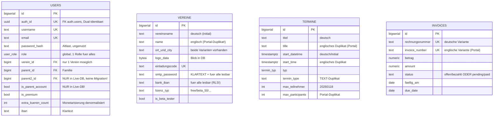

# 07 – Datenbank-Schema (RollsportManager v1 → v2)

**Rolle:** Datenbank-Architekt
**Datum:** 2026-07-09
**Untersuchte Quellen:**
- `/Users/marcelgoldfuss/Apps/RollsportManager/rollsportmanager-backend/migrations/` (34 Dateien, ~8.400 Zeilen SQL)
- `/Users/marcelgoldfuss/Apps/RollsportManager/rollsportmanager-backend/sql/` (5 Ad-hoc-Skripte)
- `/Users/marcelgoldfuss/Apps/RollsportManager/rollsportmanager-backend/supabase/migrations/` (Fast-Duplikat von `migrations/`)
- `/Users/marcelgoldfuss/Apps/RollsportManager/rollsportmanager-backend/www/portal/database-migration.sql` (718 Zeilen, Parallel-Schema!)
- `/Users/marcelgoldfuss/Apps/RollsportManager/rollsportmanager-ios-macos/FIX-*.sql`, `COMPLETE-FIX.sql`, `SUPABASE-SYNC-SETUP.sql`, `SQL/*.sql`
- `/Users/marcelgoldfuss/Apps/RollsportManager/rollsportmanager-android/supabase/migrations/20260119_pflichtstunden.sql`
- `HARMONISIERUNGSPLAN.md`, `CLAUDE.md` (Backend + iOS + Android)

---

## 1. Überblick

Die Produktions-Datenbank ist ein self-hosted **Supabase-Postgres** (Docker, Kong-Gateway, PostgREST, GoTrue-Auth, Storage, Realtime). Das Schema ist über **mindestens fünf unabhängige Quellen** gewachsen:

1. **Initial-Schema** `migrations/20251230_initial_schema.sql` – 18 Kerntabellen, 8 deutsche Enums, RLS-Grundgerüst.
2. **Feature-Migrationen** in `migrations/` – Monetarisierung, Push, Zahlungen, Finanzen, Wettkampf, Trainingsplanung, Backup/Archivierung usw.
3. **Portal-Parallel-Migration** `www/portal/database-migration.sql` – erstellt eine *zweite Welt* mit englischen Namen (memberships, facilities, equipment, checkins, waitlist, QR-Codes, eigene `invoices`/`payments`-Varianten!).
4. **iOS-seitige Fix-/Setup-Skripte** (`FIX-ALL.sql`, `SUPABASE-SYNC-SETUP.sql`, `SQL/…`) – u. a. `team_trainers` (Duplikat zu `team_trainer`), `premium_packages`, `invoice_settings`, `email_settings`, temporär **komplett offene RLS-Policies**.
5. **Android-seitige Migration** – `pflichtstunden`-Feature inkl. neuer `vereine`-Spalten.

In Summe definieren die Skripte **~80 unterschiedliche Tabellennamen** (davon mehrere konkurrierende Varianten derselben fachlichen Tabelle), **11 Enums**, **~178 `CREATE POLICY`-Statements** und **~163 Indizes**. Es gibt **kein Migrations-Tracking** (keine `schema_migrations`-Tabelle, kein Tool) – die Skripte wurden laut Kommentaren manuell „im Supabase SQL-Editor“ ausgeführt (`www/portal/database-migration.sql:5`, `FIX-ALL.sql:4`). Der tatsächliche Zustand der Live-DB ist daher **nur aus der Live-DB selbst rekonstruierbar**, nicht aus dem Repo – das ist der zentrale Befund dieses Reports.

---

## 2. Ist-Zustand im Detail

### 2.1 Kern-Schema (Initial, `migrations/20251230_initial_schema.sql`)

**Enums (deutsch):**

| Enum | Werte | Datei/Zeile |
|---|---|---|
| `user_role` | mitglied, trainer, moderator, admin (+ später `kassenwart`, `super_admin`) | initial:9, `20260122_add_kassenwart_role.sql:7`, `20260225_super_admin_role.sql:16` |
| `verein_status` | pending, active | initial:10 |
| `termin_typ` | training, wettkampf, event | initial:11 |
| `response_typ` | zusage, absage, vielleicht, krank | initial:12 |
| `anwesenheit_status` | anwesend, abwesend, entschuldigt | initial:13 |
| `kuer_status` | in_arbeit, bereit, wettkampf, archiviert | initial:14 |
| `invitation_status` | pending, accepted, expired, revoked | initial:15 |
| `kuer_media_typ` | video, bild, audio, dokument | initial:16 |
| `report_reason` / `report_status` | (englisch!) | `20260110_message_reports.sql:5,14` |
| `ubung_kategorie` | aufwaermen … kombination | `sql/create_ubungen_table.sql:8` |

**Kerntabellen:** `vereine`, `users`, `teams`, `team_members`, `team_trainer`, `termine`, `termin_responses`, `attendance`, `messages`, `kueren`, `kuer_ratings`, `kuer_notizen`, `kuer_video_timestamps`, `kuer_media`, `verein_news`, `invitations`, `trainingsplaene`, `documents`.

Zentrale Design-Entscheidungen des Initial-Schemas:
- **BIGSERIAL-PKs** überall; `users.auth_id UUID` referenziert `auth.users(id)` → **Dual-Identität** (jede RLS-Policy braucht einen Lookup `get_current_user_id()`, initial:313).
- `users.password_hash TEXT` existiert, obwohl Supabase Auth die Passwörter hält (initial:54, Kommentar „Optional“).
- `vereine.logo_data BYTEA` / `banner_data BYTEA` – **Bilder als Blobs in der DB** (initial:32–33); später kommt `kuer_media.file_data TEXT` dazu (Base64-Medien! `20260118_sync_ios_android_models.sql:10`, bestätigt in Backend-`CLAUDE.md`: „kuer_media (Base64)“).
- Zirkulärer FK `vereine.user_id → users.id` nachträglich (initial:67).
- Ein User gehört genau **einem** Verein (`users.verein_id`) und hat genau **eine** globale Rolle (`users.role`) – Mehrvereins-Mitgliedschaft oder unterschiedliche Rollen pro Verein sind im Modell unmöglich.

### 2.2 Feature-Migrationen (Auswahl mit Tabellen)

| Migration | Tabellen / Änderungen |
|---|---|
| `20260103_website_tables.sql` | `website_content`, `website_images` (CMS, öffentlich lesbar) |
| `20260109_push_notifications.sql` | `device_tokens`, `notification_settings`, `notification_log`; pg_notify-Trigger |
| `20260109_push_triggers.sql` | `push_queue` (selbstgebaute Queue, abgearbeitet von `workers/push-worker.js` per Polling/Status-Update) |
| `20260109_monetization.sql` | `user_subscriptions`, `user_purchases`, `monetization_settings`; RPCs `get_user_limits`, `process_purchase`, `activate_premium` |
| `20260111_payment_system.sql` | `verein_payment_config` (inkl. `stripe_secret_key`, `paypal_client_secret` **im Klartext**), `invoices`, `invoice_items`, `payments`, `sepa_mandate` – alles **deutsch** benannt (rechnungsnummer, betrag, faellig_am, Status `offen/bezahlt/...`) |
| `20260119_schliessfach_vermietung.sql` | `schliessfaecher`, `schliessfach_vermietungen` |
| `20260122_license_payment_config.sql` | `license_packages`, `payment_method_config` (wieder API-Secrets als Spalten: `api_key_secret`) |
| `20260127_verein_email_settings.sql` | SMTP-Spalten direkt auf `vereine`, inkl. `smtp_password` mit Kommentar „Verschlüsselt speichern in Produktion!“ (Zeile 8) – nicht umgesetzt |
| `20260201_trainingsplanung.sql` | `uebungen`, `trainingsplan_vorlagen`, `trainingsplan_uebungen`, `trainingsplan_zuweisung`, `trainingsplan_fortschritt` |
| `20260201_achievements.sql` | `achievements`, `user_achievements` |
| `20260201_wettkampf_modus.sql` | `wettkampf_details` (1:1 an `termine`), `wettkampf_starter` (Live-Status, Scores) |
| `20260201_ueberregionale_events.sql` | `ueberregionale_events`, `event_vereine`, `event_teilnehmer` (Cross-Verein!) |
| `20260201_guest_trainer_access.sql` | `guest_trainer_access` (Token-basierter Gastzugang, SELECT-Policy `USING (true)` Zeile 67) |
| `20260215_finance_tables.sql` | `budget_positionen`, `kassenbuchungen`, `mahnungen`, `spendenbescheinigungen`; ALTERs für `users.iban/bic`, `vereine.glaeubiger_id/bank_iban/bank_bic` |
| `20260215_backup_archivierung.sql` | `audit_log`, `archived_data`, `verein_backups`, `verein_backup_settings`, `compliance_reports` (GoBD-orientiert, 10 Jahre Retention) |
| `20260215_gallery_documents.sql` | `gallery_albums`, `gallery_photos`, **erneut** `documents` (andere Spalten als initial!) |
| `20260216_register_user_rpc.sql` / `20260219_fix_register_rpc_no_session.sql` | SECURITY-DEFINER-RPCs `register_user`, `register_verein`, `register_user_and_verein` als Workaround für kaputte RLS-INSERT-Pfade; 20260219 lockert `auth.uid()`-Prüfung (E-Mail-Confirm-Fall) |
| `20260225_super_admin_role.sql` | Rollentrennung Plattform/Verein; Helper `is_super_admin()`, `is_admin_or_higher()` …; hartkodiertes `UPDATE users SET role='super_admin' WHERE id = 15` (Zeile 19) |

### 2.3 Das Parallel-Schema des Portals (`www/portal/database-migration.sql`)

Diese Datei ist die größte Altlast. Sie:

- erstellt `vereine` **neu mit englischen Spalten** (`name`, `slug`, `address`, `city`, `postal_code`, `country`, `settings JSONB` – Zeile 12–30), während das Initial-Schema `vereinsname`, `strasse`, `ort`, `plz` hat. Da beide `IF NOT EXISTS` verwenden, gewinnt, was zuerst lief – und die RPC `register_verein` (`20260216_register_user_rpc.sql:157`) schreibt in `name/address/city/country`, während Portal-Seiten wie `www/portal/verein-settings.html` und `www/assets/js/portal.js` weiterhin `vereinsname` lesen. **Die Live-`vereine`-Tabelle trägt also beide Spaltensätze parallel.**
- fügt `termine` **englische Duplikat-Spalten** hinzu: `title`, `description`, `termin_type`, `start_time`, `end_time`, `location`, `max_participants` (Zeile 136–150) – neben den deutschen `titel`, `beschreibung`, `typ`, `start_datetime`, `ort` und dem später ergänzten `max_teilnehmer` (`20260118_sync_ios_android_models.sql:26`). → Dieselbe Fachinformation existiert doppelt, Konsistenz undefiniert.
- erstellt `termin_teilnahmen` (TEXT-Status `pending/confirmed/declined/maybe`, Zeile 153) **zusätzlich** zu `termin_responses` (Enum `zusage/absage/...`) – zwei RSVP-Systeme.
- erstellt **eigene `invoices`/`payments`** mit englischen Spalten (`invoice_number`, `amount`, `total_amount`, `due_date`, Status `pending/paid/...`, Zeile 248–291), die mit der deutschen Variante aus `20260111_payment_system.sql` kollidieren. Je nach Ausführungsreihenfolge fehlt einer der Spaltensätze → das erklärt die vielen „falsche Spaltennamen“-Bugs aus Backend-`CLAUDE.md` („Bekannte Probleme #2“).
- erstellt die Modul-Tabellen `membership_categories`, `membership_discounts`, `memberships`, `facilities`, `facility_bookings` (2×, Zeile 328 und 544!), `equipment_categories`, `equipment_items`, `equipment_reservations`, `waitlist`, `member_qrcodes`, `checkins`, `guest_booking_requests`.
- fügt `users` ~20 Spalten hinzu (`birth_date`, `parent_id`, `account_type`, `can_book_independently`, …) und setzt `role TEXT DEFAULT 'member'` (Zeile 47) – **im Konflikt mit dem Enum `user_role` und dessen Default `mitglied`**.

### 2.4 Plattform-seitige Ad-hoc-Skripte (Drift-Verursacher)

- `rollsportmanager-ios-macos/FIX-ALL.sql`: legt `team_trainers` an (Zeile 41) – **Duplikat** zu `team_trainer` aus dem Initial-Schema – und ersetzt die `users`-, `team_members`-, `team_trainers`-Policies durch **`USING (true)` für alle authenticated User** („TEMPORÄR“, Zeile 61/90). Spätere Migrationen (`20260215_hide_admin_from_moderators.sql`, dort `DROP POLICY IF EXISTS "allow_all"` Zeile ~6) räumen nur teilweise auf.
- `rollsportmanager-ios-macos/SQL/create_premium_packages.sql`, `create_invoice_settings.sql`, `email_settings.sql`: Tabellen `premium_packages`, `invoice_settings`, `email_settings` existieren **nur** in App-Repo-Skripten, nicht im Backend-Migrationsordner.
- `rollsportmanager-android/supabase/migrations/20260119_pflichtstunden.sql`: Tabelle `pflichtstunden` + 6 `vereine`-Spalten. Die Original-Summary-Funktion referenzierte `u.vorname/u.nachname` und `role='eltern'` – **Spalten/Enum-Wert, die es nie gab**; der Fix `migrations/20260213_fix_pflichtstunden_function.sql` stellt auf `first_name/last_name` und `is_parent_account`/`parent2_id` um. **`is_parent_account` und `parent2_id` tauchen in keiner Migration als `ADD COLUMN` auf** – sie wurden offenbar direkt in der Live-DB angelegt. Gleiches gilt für `messages.image_url` (nur als Anweisung in iOS-`CLAUDE.md`), `verein_news.news_typ`/`team_id`/`priority` (vom Push-Trigger `20260109_push_notifications.sql:249` referenziert, nie migriert).
- `sql/create_ubungen_table.sql` legt `ubungen` an (**UUID-PK!**, Zeile 22) – parallel zu `uebungen` (BIGSERIAL) aus `20260201_trainingsplanung.sql:11`. Zwei Übungsbibliotheken mit fast identischem Zweck.
- `documents` existiert in **vier Varianten**: initial (titel/beschreibung), `sql/create_gallery_tables.sql` (name/category/is_public), `sql/create_gallery_documents_tables.sql` (name/kategorie) und `migrations/20260215_gallery_documents.sql` (name/`kategorie TEXT DEFAULT 'other'` – deutscher Spaltenname mit englischem Default).
- `migrations/` vs. `supabase/migrations/`: fast identische Duplikate; `20260225_super_admin_role.sql` und `add_language_column.sql` existieren **nur** in `migrations/` → unklar, welcher Ordner „gilt“.

### 2.5 RLS & Sicherheit

- **Mandantentrennung** ausschließlich über RLS mit Helper-Funktionen `get_current_user_id()` / `get_current_verein_id()` (SECURITY DEFINER, initial:313–322, **ohne `SET search_path`** – nur die neueren Registrier-RPCs pinnen ihn). Jede Policy-Auswertung macht Subselects auf `users`/`teams` → N Lookups pro Query.
- **Kritisch:** Die `vereine`-SELECT-Policy `USING (status = 'active')` (initial:325) macht **jede aktive Vereinszeile für alle lesbar** – inklusive der später hinzugefügten Spalten `smtp_password`, `bank_iban`, `glaeubiger_id`, Pflichtstunden-Konfiguration usw. Es gibt keine spaltenbasierte Absicherung (kein View, kein column-level GRANT).
- Offene Policies `USING (true)`: `website_content`/`website_images` (ok, CMS), `license_packages` (ok), aber auch `guest_trainer_access` SELECT (`20260201_guest_trainer_access.sql:67` – Token-Tabelle mit E-Mail-Adressen!) und historisch `users`/`team_members`/`team_trainers` via `FIX-ALL.sql`.
- Viele UPDATE-Policies **ohne `WITH CHECK`** (z. B. initial `Users: Eigenes Profil bearbeiten` – ein User könnte `verein_id`/`role` seines eigenen Datensatzes ändern, sofern kein Trigger das verhindert; `payments_insert` erlaubt INSERT mit beliebiger `user_id`, solange der Einfügende Admin ist – akzeptabel, aber uneinheitlich).
- `FOR ALL USING (…)`-Policies (Teams, Termine initial:339–353) statt getrennter Kommando-Policies → DELETE/UPDATE für jedes Vereinsmitglied möglich (jedes Mitglied kann Teams/Termine seines Vereins löschen!). Spätere Migrationen differenzieren das nur für einzelne Tabellen nach.
- Laut Security-Audit-Kontext (2026-06-13) läuft die Instanz zudem mit dem **öffentlichen Supabase-Demo-JWT-Secret** (Backend-`CLAUDE.md`: „JWT_SECRET: Supabase CLI Demo-Secret“). Damit ist jede RLS-Diskussion akademisch: `service_role`-Tokens sind fälschbar. Für v2 höchste Priorität.
- Storage: Buckets `avatars`, `verein-media`, `chat-images` **öffentlich**; `kuer-media`, `documents` privat (initial:383–392, iOS-`CLAUDE.md`).

### 2.6 Funktionen, Trigger, Jobs

- ~40 RPC-/Helper-Funktionen (Limits, Käufe, Registrierung, Rollen, Pflichtstunden, Rechnungsnummern …), fast alle `SECURITY DEFINER`.
- `generate_invoice_number()` (`20260111_payment_system.sql:284`) zählt per `COUNT(*)+1` → **Race-Condition**; bei parallelen Rechnungen kollidiert die UNIQUE-Rechnungsnummer.
- `updated_at`-Trigger existieren nur punktuell (website_content, ubungen, payment-Tabellen); die meisten Tabellen haben `updated_at` ohne Pflege.
- Push-Pipeline: Trigger → `push_queue` → Node-Worker (`workers/push-worker.js`) pollt und setzt `status='processing'` – ohne `FOR UPDATE SKIP LOCKED`-Muster erkennbar, ohne Aufräum-/Retention-Job.
- Realtime-Publikationen für 12 Tabellen (u. a. `messages`, `termin_responses`, `wettkampf_starter`).

### 2.7 Indizes

~163 `CREATE INDEX` über alle Skripte – FK-Spalten der neueren Modul-Tabellen sind ordentlich indiziert. Lücken im Kern: `attendance(user_id)`, `termin_responses(user_id)`, `kuer_media(kuer_id)`, `kuer_ratings(kuer_id)`, `documents(verein_id)` (initial), `messages(recipient_id, is_read)` für Unread-Counts, sowie durchgängig fehlende **Composite-Indizes `(verein_id, …)`** für die typischen mandantengefilterten Listenabfragen. Keine partiellen/covering-Indizes außer `device_tokens(is_active) WHERE is_active` (gut!).

---

## 3. ER-Diagramm (rekonstruierter Kern, Mermaid)

```mermaid
erDiagram
    VEREINE ||--o{ USERS : "verein_id"
    USERS   ||--o{ VEREINE : "gruendet (vereine.user_id)"
    USERS   ||--o{ USERS : "parent_id / parent2_id"

    VEREINE ||--o{ TEAMS : "verein_id"
    TEAMS   ||--o{ TEAM_MEMBERS : ""
    USERS   ||--o{ TEAM_MEMBERS : ""
    TEAMS   ||--o{ TEAM_TRAINER : ""
    USERS   ||--o{ TEAM_TRAINER : "trainer_id"

    VEREINE ||--o{ TERMINE : "verein_id"
    TEAMS   ||--o{ TERMINE : "team_id"
    FACILITIES ||--o{ TERMINE : "facility_id"
    TERMINE ||--o{ TERMIN_RESPONSES : ""
    TERMINE ||--o{ ATTENDANCE : ""
    TERMINE ||--|| WETTKAMPF_DETAILS : "1:1"
    WETTKAMPF_DETAILS ||--o{ WETTKAMPF_STARTER : ""

    USERS ||--o{ KUEREN : "user_id (Besitzer)"
    USERS ||--o{ KUEREN : "created_by (Trainer)"
    TEAMS ||--o{ KUEREN : "team_id"
    KUEREN ||--o{ KUER_MEDIA : ""
    KUEREN ||--o{ KUER_RATINGS : ""
    KUEREN ||--o{ KUER_NOTIZEN : ""
    KUEREN ||--o{ KUER_VIDEO_TIMESTAMPS : ""

    TEAMS ||--o{ MESSAGES : "team_id (Team-Chat)"
    USERS ||--o{ MESSAGES : "sender_id / recipient_id (DM)"
    MESSAGES ||--o{ MESSAGE_REPORTS : ""

    VEREINE ||--o{ MEMBERSHIP_CATEGORIES : ""
    MEMBERSHIP_CATEGORIES ||--o{ MEMBERSHIPS : ""
    USERS ||--o{ MEMBERSHIPS : ""
    MEMBERSHIPS ||--o{ INVOICES : ""
    INVOICES ||--o{ INVOICE_ITEMS : ""
    INVOICES ||--o{ PAYMENTS : ""
    INVOICES ||--o{ MAHNUNGEN : ""
    USERS ||--o{ SEPA_MANDATE : ""
    VEREINE ||--|| VEREIN_PAYMENT_CONFIG : "1:1"
    VEREINE ||--o{ KASSENBUCHUNGEN : ""
    VEREINE ||--o{ BUDGET_POSITIONEN : ""
    VEREINE ||--o{ SPENDENBESCHEINIGUNGEN : ""

    VEREINE ||--o{ FACILITIES : ""
    FACILITIES ||--o{ FACILITY_BOOKINGS : ""
    VEREINE ||--o{ EQUIPMENT_ITEMS : ""
    EQUIPMENT_ITEMS ||--o{ EQUIPMENT_RESERVATIONS : ""
    USERS ||--o{ CHECKINS : ""
    USERS ||--|| MEMBER_QRCODES : "1:1"
    VEREINE ||--o{ WAITLIST : "polymorph: waitlist_type + reference_id"

    VEREINE ||--o{ SCHLIESSFAECHER : ""
    SCHLIESSFAECHER ||--o{ SCHLIESSFACH_VERMIETUNGEN : ""
    USERS ||--o{ PFLICHTSTUNDEN : "user_id (Eltern)"

    VEREINE ||--o{ UEBUNGEN : ""
    TRAININGSPLAN_VORLAGEN ||--o{ TRAININGSPLAN_UEBUNGEN : ""
    UEBUNGEN ||--o{ TRAININGSPLAN_UEBUNGEN : ""
    TRAININGSPLAN_VORLAGEN ||--o{ TRAININGSPLAN_ZUWEISUNG : ""
    TRAININGSPLAN_ZUWEISUNG ||--o{ TRAININGSPLAN_FORTSCHRITT : "logisch"

    UEBERREGIONALE_EVENTS ||--o{ EVENT_VEREINE : ""
    UEBERREGIONALE_EVENTS ||--o{ EVENT_TEILNEHMER : ""
    VEREINE ||--o{ EVENT_VEREINE : ""

    USERS ||--o{ USER_SUBSCRIPTIONS : ""
    USERS ||--o{ USER_PURCHASES : ""
    VEREINE ||--|| MONETIZATION_SETTINGS : "1:1"
    USERS ||--o{ DEVICE_TOKENS : ""
    USERS ||--|| NOTIFICATION_SETTINGS : "1:1"

    VEREINE ||--o{ GALLERY_ALBUMS : ""
    GALLERY_ALBUMS ||--o{ GALLERY_PHOTOS : ""
    VEREINE ||--o{ DOCUMENTS : ""
    VEREINE ||--o{ VEREIN_NEWS : ""
    VEREINE ||--o{ INVITATIONS : ""
    VEREINE ||--o{ AUDIT_LOG : ""
    VEREINE ||--o{ VEREIN_BACKUPS : ""
```



Wichtige Attribut-Details der Kerntabellen:



---

## 4. Stärken

1. **Fachlich reichhaltiges Domänenmodell**: Der Funktionsumfang (Küren mit Medien/Timestamps/Bewertungen, Wettkampf-Livemodus, überregionale Events, Pflichtstunden, Mahnwesen, Spendenbescheinigungen, GoBD-Archivierung) ist ungewöhnlich vollständig für eine Vereins-App und eine hervorragende fachliche Vorlage für v2.
2. **RLS von Anfang an aktiviert** – Multi-Tenancy wurde nie „vergessen“, nur inkonsistent umgesetzt. Die Helper-Funktions-Idee (`get_current_user_id()`) ist prinzipiell richtig.
3. **Durchdachte Einzelmodule**: `20260215_backup_archivierung.sql` (Audit-Log mit old/new-JSONB, Retention, Compliance-Reports), `20260113_attendance_policies.sql` (saubere rollenbasierte Policies mit `is_trainer_for_termin`), `20260110_message_reports.sql` (Moderation) sind handwerklich gut.
4. **Idempotenz-Bewusstsein**: Spätere Migrationen nutzen konsequent `IF NOT EXISTS` / `DROP POLICY IF EXISTS` / DO-Blöcke – Wiederausführbarkeit war ein Ziel (wenn auch als Symptom des fehlenden Migrationstools).
5. **Monetarisierung im Backend abgebildet**: Limits, Käufe, Abos als RPCs serverseitig berechnet (`get_user_limits`), nicht nur clientseitig – inkl. Idempotenz-Check auf `store_transaction_id` (`process_purchase`).
6. **Indizes auf FK-Spalten** bei den neueren Tabellen konsequent; partieller Index auf `device_tokens` zeigt Verständnis.
7. **Realtime & Push architektonisch integriert** (Publikationen, Trigger, Queue-Tabelle mit Retry-Zähler).

---

## 5. Schwächen / Altlasten

1. **Keine einzige Quelle der Wahrheit**: 5 Schema-Quellen (Backend-Migrationen, Portal-SQL, iOS-Skripte, Android-Migration, direkte Live-DB-Änderungen), kein Migrationstool, kein Tracking, `migrations/` vs. `supabase/migrations/` divergieren. Spalten wie `users.parent2_id`, `is_parent_account`, `messages.image_url`, `verein_news.news_typ` existieren **nur in der Live-DB**.
2. **Deutsch/Englisch-Mischmasch bis auf Spaltenebene**: `vereine.vereinsname` **und** `vereine.name`; `termine.titel/start_datetime/ort` **und** `title/start_time/location` **und** `max_teilnehmer`+`max_participants`; `documents.kategorie DEFAULT 'other'`. Enums deutsch, Status-TEXTe mal deutsch (`offen`), mal englisch (`pending`).
3. **Kollidierende Doppel-Tabellen**: `invoices`/`payments` in zwei inkompatiblen Varianten (Portal englisch vs. Migration deutsch), `team_trainer` vs. `team_trainers`, `uebungen` (BIGSERIAL) vs. `ubungen` (UUID), `termin_responses` vs. `termin_teilnahmen`, `documents` in 4 Versionen, `waitlist` vs. dokumentiertem `waitlists`, `facility_bookings` doppelt in derselben Datei (`database-migration.sql:328` und `:544`).
4. **Sicherheits-Altlasten**:
   - Vereins-SELECT-Policy `status='active'` exponiert `smtp_password`, `bank_iban`, `glaeubiger_id` an **alle** (initial:325 + `20260127`/`20260215_finance`).
   - Payment-Secrets (`stripe_secret_key`, `paypal_client_secret`, `api_key_secret`) als Klartext-Spalten in mandantenlesbaren Tabellen.
   - `FIX-ALL.sql`-Ära: `USING (true)`-Policies auf `users`/`team_members`; Reste unklar.
   - SECURITY-DEFINER-Funktionen ohne `SET search_path` (initial:313 ff.).
   - Demo-JWT-Secret in Produktion (Backend-`CLAUDE.md`) hebelt RLS komplett aus.
   - `admin_update_user_role` in der FIX-Version **ohne Berechtigungsprüfung** für alle authenticated ausführbar (`FIX-ALL.sql:16–34`).
5. **Dual-Identität `users.id BIGINT` ↔ `auth_id UUID`**: erzwingt Lookup-Funktionen in jeder Policy (Performance), RPC-Workarounds bei der Registrierung (drei Reparatur-Migrationen 20260215/16/19) und doppelte FK-Semantik (`website_content.updated_by` referenziert `auth.users`, alles andere `users`).
6. **Ein-Verein-ein-Rollen-Modell**: `users.verein_id` + globale `users.role` verhindern Mehrvereins-Mitgliedschaft, Gasttrainer mussten als eigene Token-Tabelle (`guest_trainer_access`) drangeflickt werden; Android erwartete sogar eine nie existierende Rolle `eltern`.
7. **Medien/Blobs in der DB**: `vereine.logo_data/banner_data BYTEA`, `kuer_media.file_data TEXT` (Base64) – DB-Bloat, langsame Backups, obwohl Supabase Storage vorhanden ist und teils genutzt wird (inkonsistent: `logo_url` **und** `logo_data`).
8. **Finanzdaten löschbar**: `invoices.user_id … ON DELETE CASCADE` (beide Varianten) – Löschen eines Users vernichtet Rechnungen (GoBD/Aufbewahrungspflicht!). `admin_delete_user` (20260215) doktert an FK-Symptomen herum statt am Modell.
9. **Race-Conditions**: Rechnungsnummern per `COUNT(*)+1`; `waitlist.position` per `MAX(position)+1` ohne Sperre; `push_queue`-Worker ohne `SKIP LOCKED`.
10. **Denormalisierung ohne Pflege**: `users.is_premium/premium_until` parallel zu `user_subscriptions`; `gallery_albums.photo_count`; `monetization_settings.verein_license_active` parallel zu `vereine.lizenz_typ` + `license_packages` – drei Lizenz-Wahrheiten.
11. **`updated_at` überall, Trigger fast nirgends**; TIMESTAMP-Typen gemischt (`TIMESTAMPTZ` vs. `TIMESTAMP WITH TIME ZONE` ok, aber `TIME`-Spalten für Buchungen ohne Datum/Zeitzone).
12. **Polymorphe Referenz ohne FK**: `waitlist.reference_id` + `waitlist_type` (Textweiche) – nicht constraint-fähig; ebenso `archived_data.original_id`, `audit_log.record_id` (dort vertretbar).
13. **Status als freier TEXT** in >20 Tabellen, nur teils mit CHECK; identische Zustände heißen je Tabelle anders (`aktiv`/`active`/`bestaetigt`/`confirmed`).
14. **Indizes-Lücken im Kern** (siehe 2.7) und keine Composite-Indizes für Mandanten-Queries; `messages` ohne Index für Unread-Zählung.
15. **RLS `FOR ALL`-Policies** geben jedem Vereinsmitglied DELETE-Rechte auf Teams/Termine (initial:339, 349).
16. **Fehlende Constraints**: kaum `CHECK (end > start)` bei Zeiträumen, keine Exclusion-Constraints gegen Doppelbuchungen von Facilities/Schließfächern, `termine.verein_id` nullable (Termin ohne Mandant möglich).

---

## 6. Empfehlungen für das v2-Schema

### 6.1 Fundament & Prozess

1. **Ein Migrationssystem, ein Ordner, CI-geprüft**: Supabase CLI-Migrationen (oder Drizzle/Atlas) als einzige Schemaquelle; `supabase db diff` gegen Prod verboten außer im Tooling; Apps liefern **nie** eigene SQL-Skripte aus. Erster Schritt: `pg_dump --schema-only` der Live-DB als Baseline einchecken.
2. **Namenskonvention festschreiben** (eine Seite im Blueprint): Tabellen/Spalten **englisch**, snake_case, Singular-Domänenbegriffe als Fachvokabular erlaubt (`kuer` ist als Fachbegriff ok: `routines` oder `kuers` – Entscheidung dokumentieren, dann konsequent). UI bleibt deutsch/bilingual über i18n – nicht über Spaltennamen.
3. **Getrennte Schemata**: `app` (Tabellen), `api` (Views/RPCs, das einzige PostgREST-exponierte Schema), `internal` (Queues, Jobs). Damit sind Spalten wie SMTP-Passwörter physisch nie über die API erreichbar.
4. **pgTAP-Tests für RLS** (jede Policy mindestens ein Positiv-/Negativtest) + Linting (`squawk`) in CI.

### 6.2 Identität & Mandanten

5. **Eine Identität**: `profiles.id UUID PK REFERENCES auth.users(id)` – kein BIGSERIAL-Doppel, keine `get_current_user_id()`-Lookups mehr; `auth.uid()` ist direkt joinbar.
6. **Mitgliedschaft statt globaler Rolle**: `club_members (club_id, user_id, role club_role, status, joined_at, PRIMARY KEY(club_id, user_id))`. Rollen pro Verein (`owner`, `admin`, `treasurer`, `coach`, `member`, `guest_coach`), Mehrvereins-Fähigkeit gratis, Gasttrainer wird eine normale zeitlich befristete Mitgliedschaft (`valid_until`) statt Token-Sondertabelle. Plattform-Admin über `auth.users.app_metadata.platform_role`, nicht als Enum-Wert im Mandantenmodell.
7. **Tenant-Spalte überall Pflicht**: `club_id UUID NOT NULL` auf jeder Mandantentabelle + Composite-Index `(club_id, …)`; RLS liest die Club-Zugehörigkeit aus einem **JWT-Custom-Claim** (via Auth-Hook) statt Subselects → schnell, rekursionsfrei, ein einheitliches Policy-Template:
   ```sql
   USING (club_id IN (SELECT jwt_club_ids()))  -- stable, aus Claim
   WITH CHECK (club_id IN (SELECT jwt_club_ids_with_role('admin')))
   ```
8. **Familien** sauber als Relation: `guardianships (guardian_id, child_id, PRIMARY KEY(...))` statt `parent_id`/`parent2_id`-Spalten; Alterslogik (`child/teen/adult`) als generierte Spalte/View aus `birth_date`, nicht als Cron-gepflegtes Feld.

### 6.3 Domänenmodell konsolidieren

9. **Eine Tabelle pro Fachkonzept** – die Duplikate zusammenführen:
   - `events` (statt termine dt./engl.) mit `starts_at/ends_at TIMESTAMPTZ`, `type`, optionaler `rrule TEXT` für Wiederholungen (ersetzt `trainingsplaene`-Wochentagslogik und `facility_bookings.recurrence`).
   - `event_responses` (ein RSVP-System, Enum `going/declined/maybe/sick`) – ersetzt `termin_responses` + `termin_teilnahmen`.
   - `exercises` (eine Übungsbibliothek, ersetzt `uebungen`+`ubungen`), `team_coaches` (ersetzt `team_trainer`+`team_trainers`), `documents` (eine Version, mit `category`-Lookup).
   - `invoices`/`payments` **einmal**, englisch, mit `amount_cents BIGINT` statt DECIMAL-Euros (kein Rundungsdrama, konsistent mit `price_cents` in license_packages).
10. **Status als Enums oder Lookup-Tabellen**, ein Sprachraum, dokumentierte Zustandsautomaten (z. B. `invoice_status: draft → open → paid | overdue → cancelled`); DB-seitige Übergangs-Checks per Trigger nur wo nötig.
11. **Wettkampf-Modul beibehalten, aber normalisieren**: `competitions` (1:1 zu event), `competition_entries` (Starter inkl. Kategorie), `scores` als eigene Tabelle (statt 5 Score-Spalten) → erweiterbar für andere Wertungssysteme; `categories` als Tabelle statt JSONB-Array.
12. **Warteliste ohne Polymorphie**: je Ziel eine schlanke Tabelle (`event_waitlist`, `membership_waitlist`) oder ein FK auf eine gemeinsame `bookable_resources`-Tabelle; Position über `ROW_NUMBER()` je Query statt gepflegter `position`-Spalte.
13. **Belegungskonflikte in der DB lösen**: `EXCLUDE USING gist (facility_id WITH =, tstzrange(starts_at, ends_at) WITH &&)` auf Buchungen (btree_gist) – ersetzt applikationsseitige Prüfungen; analog für Schließfach-Vermietungszeiträume (`daterange`).

### 6.4 Finanzen & Compliance

14. **Unveränderlichkeit**: Rechnungen/Zahlungen/Spendenbescheinigungen nie `ON DELETE CASCADE` von Usern; stattdessen `user_id … ON DELETE RESTRICT` + `billing_snapshot JSONB` (Name/Adresse zum Rechnungszeitpunkt) und Soft-Delete/Anonymisierung des Users (DSGVO-konform: personenbezogene Felder nullen, Belege behalten – Art. 17(3)(b)).
15. **Rechnungsnummern race-frei**: eigene Sequenz pro Verein (`invoice_counters`-Tabelle mit `UPDATE … RETURNING` oder `nextval` dynamischer Sequenzen) statt `COUNT(*)+1`.
16. Das gute Audit-/Archiv-Konzept aus `20260215_backup_archivierung.sql` übernehmen, aber generisch per Trigger (`pgaudit` oder generischer JSONB-Trigger) statt handverdrahtet; `audit_log` partitionieren (monatlich) + `pg_cron`-Retention.

### 6.5 Sicherheit

17. **Secrets raus aus Mandantentabellen**: SMTP-/Stripe-/PayPal-Credentials in **Supabase Vault** (oder verschlüsselte `club_secrets`-Tabelle, nur via SECURITY-DEFINER-RPC aus Edge Functions lesbar). Öffentliche Vereinsdaten in eine `club_public_profiles`-View für die anonyme Website – die Basistabelle ist nie öffentlich lesbar.
18. **JWT-Secret rotieren / echte Keys** (kein Demo-Secret), `anon`-Rechte minimal, `service_role` nur serverseitig.
19. Policy-Standard: nie `FOR ALL`; immer 4 getrennte Policies mit `WITH CHECK`; alle SECURITY-DEFINER-Funktionen mit `SET search_path = ''` und expliziten Schema-Qualifizierern; kein `GRANT EXECUTE` an `anon` außer Registrierung.
20. Storage: Avatare/Logos öffentlich ok, aber `chat-images` privat mit signed URLs; Bucket-Policies pro `club_id`-Pfadpräfix.

### 6.6 Technik-Hygiene

21. **Medien nur im Storage**: `logo_data`, `banner_data`, `kuer_media.file_data` entfallen; Metadaten-Tabelle `media_assets (id, club_id, bucket, path, mime, bytes, created_by)` mit FK aus allen Modulen – ein Medienmodell für Galerie, Küren, Chat, Dokumente.
22. **`updated_at` einheitlich** per `moddatetime`-Extension-Trigger auf allen Tabellen; `created_at/updated_at TIMESTAMPTZ NOT NULL DEFAULT now()` als Standard.
23. **UUIDv7-PKs** (`gen_uuid_v7()` bzw. pg 18 `uuidv7()`) für alle neuen Tabellen – sortierbar, offline-generierbar (wichtig für die Mobile-Offline-Sync-Ambitionen der Apps), keine Enumeration-Angriffe über fortlaufende IDs in URLs.
24. **Denormalisierung nur mit Pflege**: Premium-Status ausschließlich aus `subscriptions` via View/RPC ableiten (die `users.is_premium`-Spalten entfallen); Zählerspalten (photo_count) durch Trigger oder Verzicht.
25. **Queues**: `push_queue` durch **pgmq** (in Supabase verfügbar) oder mindestens `FOR UPDATE SKIP LOCKED`-Worker ersetzen; `notification_log`/`push_queue` mit Retention-Job.
26. **Indizes nach Zugriffsmuster**: Standard pro Mandantentabelle `(club_id)`, plus gezielt `(club_id, starts_at)` für events, `(recipient_id, is_read) WHERE is_read = false` für messages, `(invoice_id)`/`(status, due_date)` für Mahnläufe. `EXPLAIN`-Budget in Code-Review.
27. **Realtime gezielt**: nur Chat/Wettkampf-Live; Broadcast-Channels statt Tabellen-Replikation wo möglich (weniger WAL-Last).

### 6.7 Vorschlag Ziel-Tabellenliste v2 (Kern, ~45 statt ~80)

`clubs`, `club_members`, `club_settings`, `club_secrets(vault)`, `profiles`, `guardianships`, `invitations`,
`teams`, `team_members`, `team_coaches`,
`events`, `event_responses`, `attendance`,
`routines (kueren)`, `routine_media`, `routine_ratings`, `routine_notes`, `routine_markers`,
`competitions`, `competition_entries`, `scores`, `interclub_events`, `interclub_event_clubs`, `interclub_entries`,
`exercises`, `training_plans`, `training_plan_items`, `training_plan_assignments`, `training_progress`,
`membership_plans`, `memberships`, `discounts`, `invoices`, `invoice_items`, `payments`, `dunning_notices`, `sepa_mandates`, `donation_receipts`, `cashbook_entries`, `budget_items`, `volunteer_hours (pflichtstunden)`,
`facilities`, `facility_bookings`, `equipment_items`, `equipment_reservations`, `lockers`, `locker_rentals`, `checkins`,
`conversations`, `messages`, `message_reports`,
`documents`, `media_assets`, `gallery_albums`, `news_posts`,
`subscriptions`, `purchases`, `plans (license/premium vereinheitlicht)`,
`device_tokens`, `notification_prefs`, `audit_log`, `cms_content`.

---

## 7. Fazit

Das v1-Schema ist fachlich beeindruckend breit, aber technisch das Ergebnis von fünf unkoordinierten Schreibquellen ohne Migrationsdisziplin: doppelte Tabellen und Spalten in zwei Sprachen, RLS mit gefährlichen Lücken (öffentlich lesbare SMTP-/Bankdaten, Demo-JWT), Blobs in der DB, löschbare Finanzdaten und Race-Conditions in Kernfunktionen. **Für v2 ist ein Neuaufbau des Schemas klar günstiger als Sanierung** – bei gleichzeitiger Übernahme des sehr guten fachlichen Modells (Küren, Wettkampf, Finanzen/GoBD, Pflichtstunden). Die drei wichtigsten Weichenstellungen: (1) eine Identität (`auth.users`-UUID) + Mitgliedschafts-Tabelle mit Rollen pro Verein, (2) ein einziges, englischsprachiges, CI-verwaltetes Migrationsset mit `api`-Schema-Grenze, (3) RLS über JWT-Claims mit pgTAP-Tests statt Subselect-Helfern.
