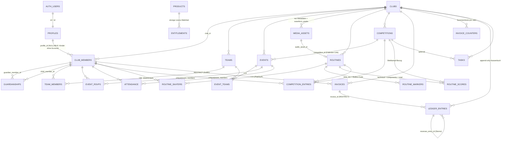

# RollsportManager v2 — Datenbank-Schema (Phase 1)

Stand: 2026-07-10 · Migrations `0001`–`0006` · getestet mit `supabase/scripts/db-test.sh`

Dieses Dokument beschreibt das v2-Schema für die Phase-1-Module (Blueprint §4/§5,
ADR-E3/E4/E6/E7). Der v1-Report `blueprint/research/07-datenbank-schema.md` ist die
Negativ-Vorlage — jede dort dokumentierte Altlast ist hier explizit geschlossen.

---

## 1. Schema-Aufteilung

| Schema | Inhalt | Sichtbar für |
|---|---|---|
| `app` | Alle Fachtabellen (23 Tabellen) | `authenticated` (RLS-gefiltert), `service_role` |
| `api` | Views + RPCs — das **einzige** PostgREST-exponierte Schema (wird vom API-Team befüllt) | `anon`, `authenticated`, `service_role` |
| `internal` | Queues/Jobs/Webhook-Idempotenz | **nur** `service_role` (kein USAGE für Clients) |

Schreibpfad im Betrieb: Clients → Hono-API-Schicht (`service_role`) → `app.*`.
RLS ist die **zweite** Verteidigungslinie, nicht die einzige (Blueprint §4).

## 2. Konventionen (hart)

- **Englisch, snake_case, ASCII** — deutsch existiert nur in i18n und in Seed-Inhalten.
- **PKs:** `uuid DEFAULT app.uuid_v7()` — zeitlich sortierbar, offline client-generierbar
  (PowerSync-Idempotenz). Die Funktion ist in `0001` definiert.
- **Geld:** `amount_cents BIGINT` + `currency CHAR(3) DEFAULT 'EUR'`. Nie Float.
- **Zeit:** `TIMESTAMPTZ` (UTC). `created_at`/`updated_at` auf jeder Tabelle;
  `updated_at` via `BEFORE UPDATE`-Trigger `app.set_updated_at()`.
- **Soft-Deletes:** `deleted_at` auf allen Sync-/Fachtabellen (PowerSync-Tombstones).
  **Ausnahme Finanzen:** `invoices`/`ledger_entries` haben kein `deleted_at` —
  GoBD-Daten werden storniert/anonymisiert, nie gelöscht (Art. 17(3)(b) DSGVO).
- **Kein `ON DELETE CASCADE` auf Finanz-FKs** — überall `RESTRICT` (v1-Fehler #8).
- **Rechnungsnummern:** `app.next_invoice_number(club_id)` über die Zählertabelle
  `invoice_counters` mit atomarem `INSERT … ON CONFLICT … RETURNING` — nie `COUNT(*)+1`
  (v1-Race). Nur `service_role` darf die Funktion ausführen.
- **Enums statt freier Status-TEXTe**, dokumentierte Zustandsautomaten:
  - `routine_status`: `draft → ready → competition → archived`
  - `invoice_status`: `draft → open → paid | cancelled`
  - `rsvp_status`: `going / declined / maybe / sick`
  - `attendance_status`: `present / late / excused / absent`
  - `competition_status`: `upcoming → running → done | cancelled`

## 3. ER-Diagramm (Kern)



Dazu: `internal.webhook_events` (Idempotenz-Ledger, `unique(provider, event_id)`) —
für Clients unsichtbar.

## 4. Tabellen (23 × `app` + 1 × `internal`)

| Bereich | Tabellen |
|---|---|
| Identität/Mandant | `clubs`, `profiles`, `club_members`, `guardianships` |
| Teams/Termine | `teams`, `team_members`, `events`, `event_teams`, `event_rsvps`, `attendance` |
| Küren (USP) | `media_assets`, `routines`, `routine_skaters`, `routine_markers`, `routine_scores` |
| Wettkampf | `competitions`, `competition_entries` |
| Finanzen | `invoice_counters`, `invoices`, `ledger_entries` |
| Plattform | `products`, `entitlements`, `tasks` + `internal.webhook_events` |

Design-Entscheidungen gegenüber der Aufgabenliste:
- **`routine_skaters`** (n:m) statt einer einzelnen `skater_id`-Spalte — der
  Demo-Verein hat eine Paarlauf-Kür („Tanz der Funken", 2 Läufer).
- **`event_teams`** (n:m) — Elternabend/Wettkampf betreffen mehrere Teams.
- `events.competition_id` verknüpft den Kalender-Termin mit dem Wettkampf-Datensatz.

## 5. Identität & Mandantenmodell (ADR-E4)

- `profiles.id = auth.users.id` — **eine** Identität, kein BIGSERIAL-Doppel.
- `club_members` trägt die **per-Club-Rolle** und die Personen-Stammdaten.
  `profile_id` ist **NULLABLE**: Kinder ohne Account sind reine Mitglieds-Zeilen,
  die Eltern über `guardianships` verwalten (Eltern-Modus).
- **Gasttrainer** = normale Mitgliedschaft mit `role = guest_coach` + Pflicht-`valid_until`
  (CHECK-Constraint). Der Ablauf wird **serverseitig** in `is_club_member`/`has_club_role`
  geprüft — nicht nur über Claims.
- Mehrverein ist im Schema ab Tag 1 möglich (`club_roles`-Claim ist eine Map
  `{club_id: role}`); die v2.0-UI bleibt Ein-Verein.

## 6. RLS-Modell

### Helper-Funktionen (SECURITY DEFINER, `search_path = ''`)

| Funktion | Zweck |
|---|---|
| `app.jwt_claims()` | `request.jwt.claims` als jsonb (`{}` wenn anonym) |
| `app.jwt_club_role(club_id)` | Rolle im Club aus dem `club_roles`-Claim |
| `app.is_club_member(club_id)` | Mitglied? — `guest_coach` zusätzlich gegen `valid_until`/`status` in der DB geprüft |
| `app.has_club_role(club_id, roles[])` | Rolle ∈ Liste? — gleiche Gast-Prüfung |
| `app.can_act_for_member(member_id)` | eigene Mitglieds-Zeile ODER eigenes Kind via `guardianships` |
| `app.next_invoice_number(club_id)` | race-freier Nummernkreis (nur `service_role`) |
| `app.uuid_v7()`, `app.set_updated_at()` | Infrastruktur |

Die Rollen kommen aus **JWT-Claims** (GoTrue Custom-Access-Token-Hook befüllt
`club_roles` aus `club_members`) — nie aus einer PATCH-baren Spalte.
Claim-Staleness ≤ 15 min: destruktive/finanzielle Operationen prüft die API-Schicht
zusätzlich gegen die DB (Blueprint Risiko #16).

### Rollen-/RLS-Matrix (Kurzform)

| Tabelle | SELECT | INSERT/UPDATE | DELETE |
|---|---|---|---|
| `clubs` | Mitglieder | owner/admin (Anlage nur API) | — (soft) |
| `profiles` | nur eigene Zeile | nur eigene Zeile | — |
| `club_members` | Mitglieder | owner/admin (+ Schutz-Trigger, s.u.) | — (soft) |
| `guardianships` | Beteiligte + owner/admin | owner/admin | — (soft) |
| `teams`, `team_members`, `events`, `event_teams` | Mitglieder | owner/admin/coach | — (soft) |
| `event_rsvps` | Mitglieder | selbst/Eltern **oder** Trainer-Stab (inkl. guest_coach) | — (soft) |
| `attendance` | Mitglieder | owner/admin/coach/guest_coach | — (soft) |
| `media_assets`, `routines`, `routine_*` | Mitglieder | owner/admin/coach/guest_coach | — (soft) |
| `competitions`, `competition_entries` | Mitglieder | owner/admin/coach | — (soft) |
| `invoices` | owner/admin/treasurer **+ eigene/Kind-Rechnungen** | owner/admin/treasurer | Trigger: nur `draft` |
| `ledger_entries` | owner/admin/treasurer | INSERT: owner/admin/treasurer | **Trigger: niemand** (Storno-Muster) |
| `invoice_counters` | — (nur service) | — | — |
| `products` | alle (nur `active`) | — (nur service) | — |
| `entitlements` | eigener Club / eigenes Profil | **— (nur service, kein Grant!)** | — |
| `tasks` | Mitglieder | owner/admin/coach + Assignee | — (soft) |
| `internal.webhook_events` | — (Schema ohne Client-USAGE) | — | — |

Grundsätze: nie `FOR ALL`-Policies, immer `WITH CHECK`, `anon` hat keinerlei
Zugriff auf `app` (öffentliche Reads später über `api`-Views).

### Geschlossene v1-Lücken (per Harness-Test belegt)

1. **Rollen-Selbst-PATCH:** `BEFORE UPDATE`-Trigger `protect_club_membership` —
   niemand ändert eigene `role/status/valid_until/profile_id`; `club_id` ist
   unveränderlich; nur Owner dürfen Owner-Zeilen anfassen. (Die API-Schicht
   arbeitet mit `service_role`-Tokens ohne `sub` und ist ausgenommen.)
2. **`activate_premium` für alle:** `entitlements` hat für Clients **kein**
   INSERT/UPDATE/DELETE-Grant und keine Schreib-Policy — nur die API-Schicht schreibt.
3. **Öffentliche Secret-Spalten:** existieren nicht; Vereins-Secrets kommen später
   in Vault/`club_secrets`, nie in mandantenlesbare Tabellen.
4. **Löschbare Finanzdaten:** `RESTRICT`-FKs + Immutability-Trigger (Kassenbuch)
   + Storno-Muster (`reverses_entry_id`).
5. **Gast-Token-Tabelle mit `USING (true)`:** ersetzt durch befristete Mitgliedschaft
   mit serverseitiger Ablauf-Prüfung.

## 7. Seed (`supabase/seed/seed.sql`)

Demo-Verein **RSV Neckarsulm**, 1:1 konsistent mit den Web-Mocks
(`apps/web/lib/mock/`): 24 Mitglieder (3 Familien, 5 `guardianships`), 3 Teams,
15 Termine **relativ zu heute** (nie veraltet), 28 RSVPs, 11 Anwesenheiten,
6 Küren mit Audio-Metadaten/96 Waveform-Peaks/22 Markern/8 Scores, 2 Wettkämpfe
mit 11 Meldungen, 10 Rechnungen (**offen = exakt 381,00 EUR**), 10 Kassenbuch-
Einträge (Saldo −277,50 EUR, Einnahmen 1:1 an Rechnungen), 7 Aufgaben,
Produktkatalog (S/M/L + Pro) und ein manuelles Beta-Entitlement.

Nur für Dev/Staging — der Seed legt Demo-Zeilen in `auth.users` an.

## 8. Test-Harness (`supabase/scripts/db-test.sh`)

```bash
supabase/scripts/db-test.sh
```

- startet `rsm2-pg-test` (postgres:16-alpine) auf **127.0.0.1:55436**, `--rm`,
  Aufräumen per `trap` garantiert — berührt keine Produktions-Container.
- installiert den Supabase-Shim (auth-Schema, `auth.uid()`/`auth.jwt()`,
  `anon`/`authenticated`/`service_role`), spielt alle Migrations + Seed ein.
- Asserts: Tabellen-/RLS-Vollständigkeit, alle Seed-Zahlen (inkl. 381,00 EUR),
  Nummernkreis (0090 → 0091), RLS-Positivfälle (Coach/Kassenwart/Eltern/Gast),
  Mandanten-Isolation (Fremd-Club sieht 0 Zeilen) und Negativfälle
  (Rollen-Selbst-PATCH, Owner-Demotion, Entitlement-Write, GoBD-Immutability,
  `webhook_events`-Sichtbarkeit, Gast-Ablauf).

## 9. Offene Punkte für Folge-Teams

- **API-Team:** `api`-Views/RPCs anlegen (PostgREST sieht nur `api`); GoTrue
  Custom-Access-Token-Hook, der `club_roles` aus `club_members` in die Claims
  schreibt; Claim-Refresh nach Rollenwechsel; Finanz-Ops zusätzlich gegen DB prüfen.
- **Sync-Team:** PowerSync Sync Rules (Tier 1/2) auf Basis der `club_id`-Spalten
  + `deleted_at`-Tombstones; Isolationstests mit zwei Vereinen.
- **pgTAP:** Der Harness deckt die Kernfälle ab; die pgTAP-Suite in
  `supabase/tests/` (Positiv/Negativ je Policy × Rolle) ist das CI-Merge-Gate
  aus Blueprint §4 und noch zu ergänzen.
- **Nicht in Phase 1:** Chat/News/Push, Übungsbibliothek, Dokumente/Galerie,
  Pflichtstunden, Hallen/Equipment/Schließfächer — kommen als aktivierbare Module.
